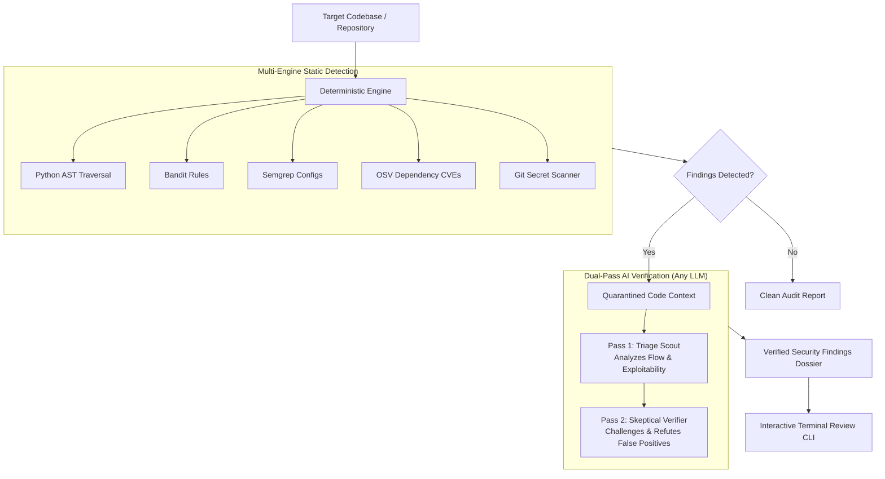

# PuedoBot Core 🛡️

[](LICENSE)
[](https://python.org)
[](#-key-capabilities)
[](#-quick-start)

**Developer-first static analysis security auditor (SAST) with dual-pass skeptical AI false-alarm elimination.**

Traditional static security tools can flood engineering teams with false alarms, while running an entire repository through an LLM is costly, slow, and context-constrained. 

**PuedoBot Core** combines deterministic static analysis with intelligent AI verification:
1. **Deterministic Speed**: Pinpoints suspicious sinks using AST traversal, Bandit patterns, Semgrep security rules, OSV CVE advisories, and git commit history secret scans.
2. **Dual-Pass AI Triage**: Quarantines suspicious code snippets and evaluates them through a two-phase challenger pipeline — a **Triage Scout** assesses exploitability, followed by a **Skeptical Verifier** acting as a defense attorney to refute false alarms.
3. **Bring Your Own AI**: Connect **ANY** cloud LLM (DeepSeek, OpenAI, Google Gemini, Groq, Mistral, OpenRouter) or run **100% offline & private** with local models (Ollama, vLLM, LM Studio).

---

## ⚡ Key Capabilities

- **🔍 Multi-Engine SAST Scanner**: Simultaneously checks AST syntax patterns, Bandit security flaws, Semgrep rules, and OSV.dev dependency advisories in a single pass.
- **🔑 Git History Secret Redaction**: Detects exposed API keys, private certificates, and database secrets across active files and historical git commits with automatic regex redaction.
- **🧠 Dual-Pass Skeptical AI Triage**:
  - *Pass 1 (Exploitation Analysis)*: Traces data sources to sinks, identifies missing sanitizers, and estimates blast radius.
  - *Pass 2 (Challenger Refutation)*: Actively searches for framework protections, defensive guards, and dead code to eliminate false positives before presenting findings.
- **🌐 Universal Model Compatibility**: Completely model-agnostic. Plug in DeepSeek, OpenAI, Gemini, Groq, or self-host open-weights models (Qwen 2.5 Coder, Llama 3, DeepSeek-R1) via Ollama or vLLM.
- **💻 Rich Interactive CLI**: Terminal dashboards with highlighted code proof dossiers, confidence scores, and review workflows.
- **🔒 Privacy First & Air-Gapped Ready**: When configured with local inference, zero code or tokens leave your environment.

---

## 🏗️ How It Works



---

## 🚀 Quick Start

### 1. Prerequisites (PostgreSQL & Python 3.11+)

PuedoBot Core stores repository audit findings, triage status, and code context in PostgreSQL. 

Start a local database in seconds using Docker:
```bash
docker run -d --name puedobot-db -p 5432:5432 -e POSTGRES_PASSWORD=postgres -e POSTGRES_DB=puedobot postgres:16-alpine
```

### 2. Installation

```bash
git clone https://github.com/eagle9111/Puedobot-Open-Source.git
cd Puedobot-Open-Source
python3 -m venv .venv
source .venv/bin/activate

# Editable install with core dependencies:
pip install -e .

# (Optional) Install with Semgrep support for multi-language rule auditing:
pip install -e ".[semgrep]"
```

> [!NOTE]
> Without `[semgrep]`, non-Python files (JS, Go, Java, PHP) receive git secret scanning and OSV dependency tracking, while Python files receive full AST, Bandit, secret, and OSV scanning.

### 3. Configuration

Copy the sample environment file:
```bash
cp .env.example .env
```

Generate a secure 32+ character API key for server authentication:
```bash
openssl rand -hex 32
# Or via Python:
python3 -c "import secrets; print(secrets.token_hex(32))"
```

Configure your database and AI preference in `.env`:

#### Option A: Cloud AI (DeepSeek, OpenAI, Groq, Gemini, OpenRouter)
```dotenv
# Server API Authentication (Required: at least 32 characters)
PUEDOBOT_API_KEY=paste_your_generated_32_byte_secret_here

# Use any OpenAI-compatible API:
AI_API_URL=https://api.deepseek.com/v1     # Or OpenAI, Groq, OpenRouter, etc.
AI_API_KEY=your_api_key_here
MODEL_NAME=deepseek-chat

# Or use Google Gemini directly:
# AI_API_URL=
# AI_API_KEY=your_gemini_api_key_here
# MODEL_NAME=gemini-2.5-flash
```

#### Option B: 100% Offline / Local (Ollama, vLLM, LM Studio)
```dotenv
PUEDOBOT_API_KEY=paste_your_generated_32_byte_secret_here

LOCAL_AI_URL=http://localhost:11434/v1
LOCAL_AI_MODEL=qwen2.5-coder:7b
AI_PRIORITY=local
```

### 4. Initialize Database & Run

```bash
# Ensure your virtual environment is active:
source .venv/bin/activate

# 1. Initialize DB tables
python3 -m scripts.init_db

# 2. Start the background scan service
uvicorn app.server.main:app --host 127.0.0.1 --port 8000 &

# 3. Audit any project or repository
puedobot scan /path/to/target/project
```

---

## 📖 CLI Commands

> [!TIP]
> Run `puedobot --help` (or simply `puedobot`) at any time to reveal all commands, subcommands, arguments, and flag options.

| Command | Description |
| :--- | :--- |
| `puedobot scan <path>` | Run a comprehensive multi-engine audit against target code |
| `puedobot show-errors` | Display interactive table of all verified security findings |
| `puedobot show <id>` | Inspect detailed vulnerability dossier and syntax-highlighted code proof |
| `puedobot review <id> <approve\|reject>` | Mark a finding as verified or dismissed |
| `puedobot repos` | List audited repositories and status |
| `puedobot activity` | Stream active audit jobs and status |

---

## 🛡️ Responsible Disclosure & Security Ethics

PuedoBot Core is created for authorized, defensive security auditing, pre-commit CI/CD quality gates, and code hardening.

## 📄 License

Apache 2.0. See [LICENSE](LICENSE) for details.
